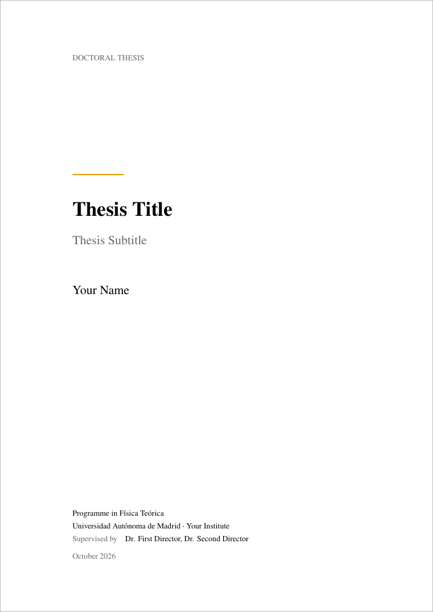
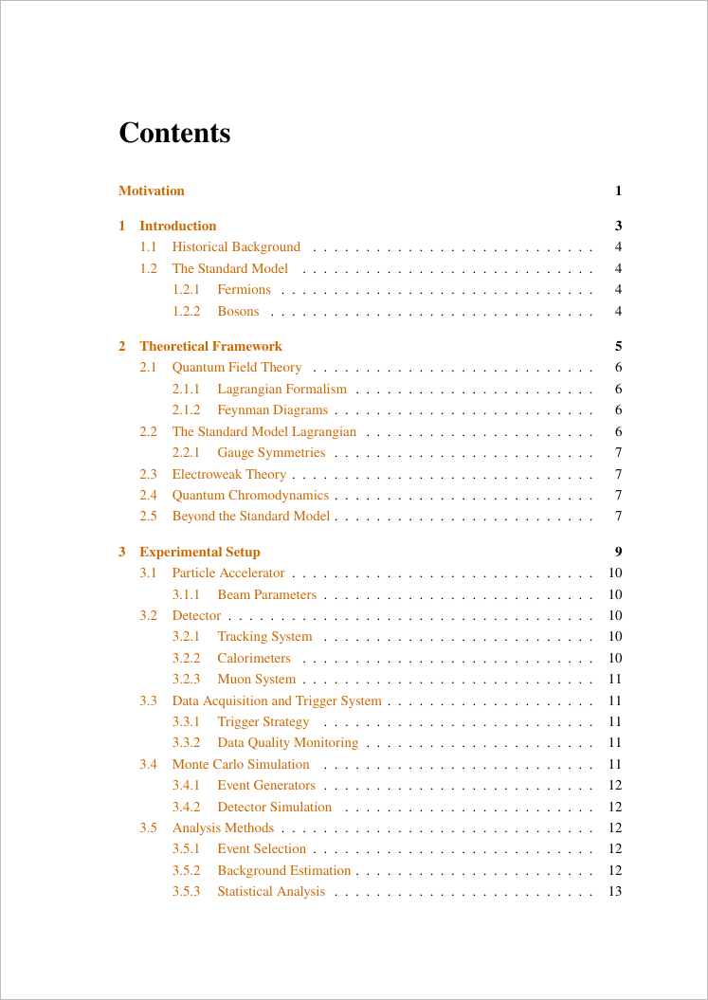
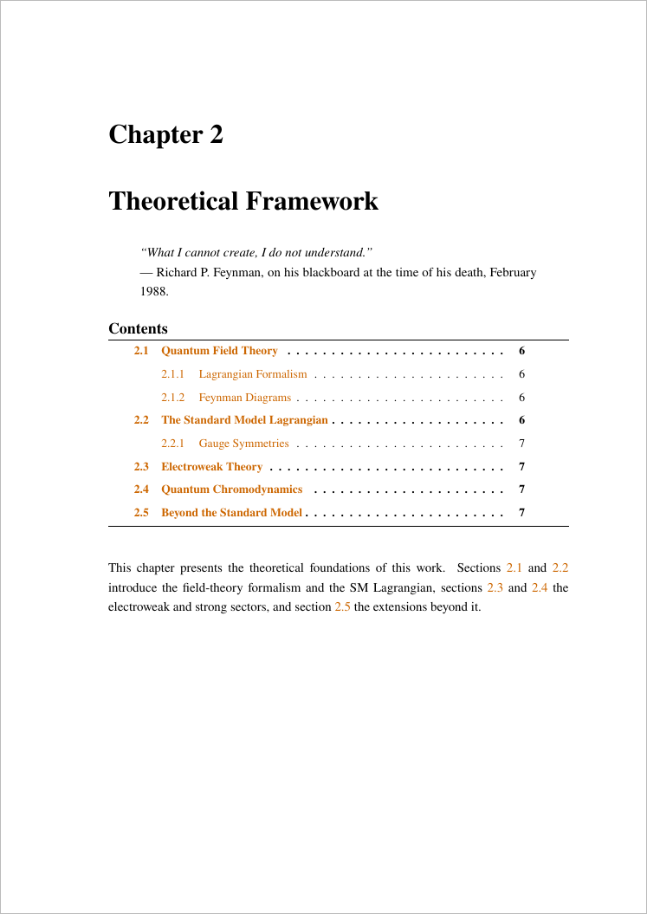
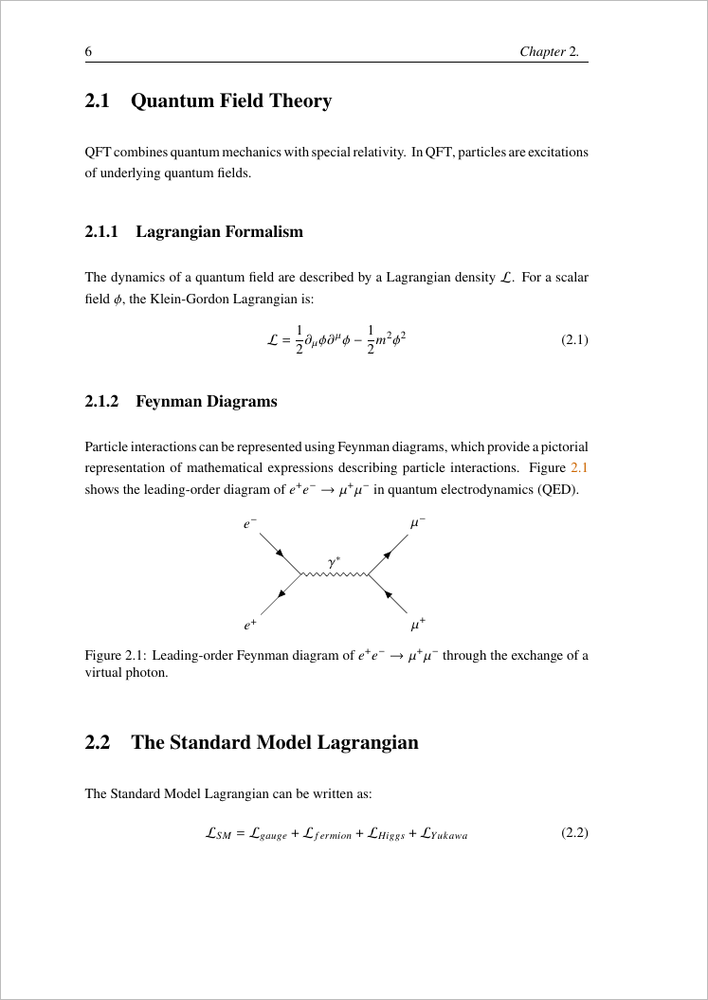
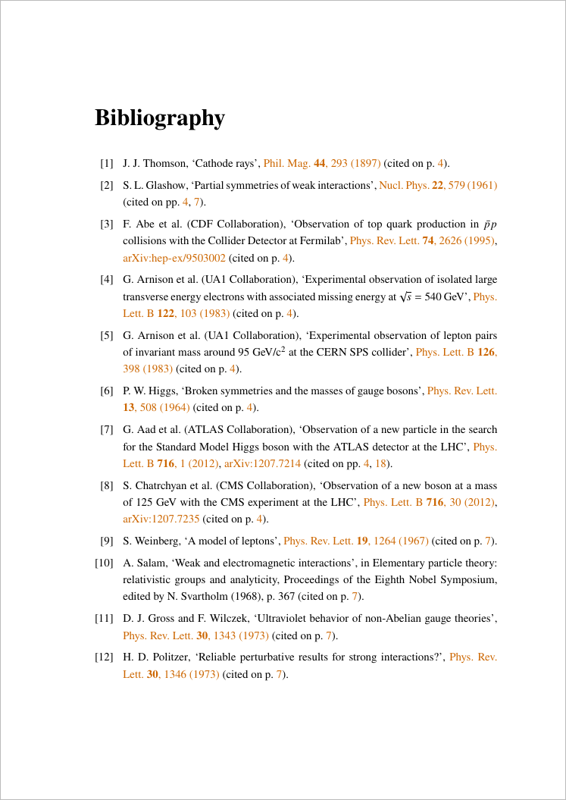
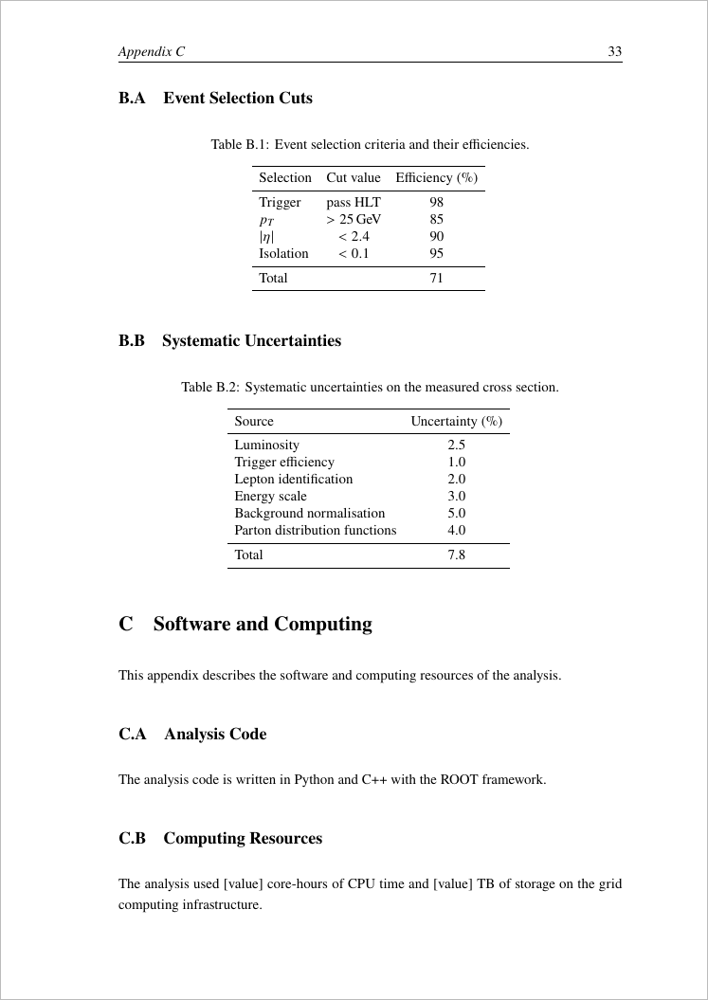
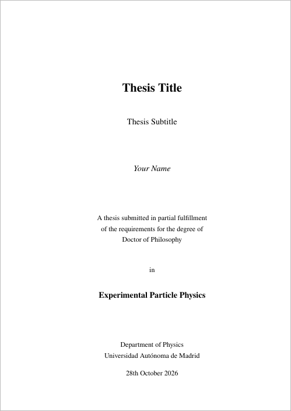
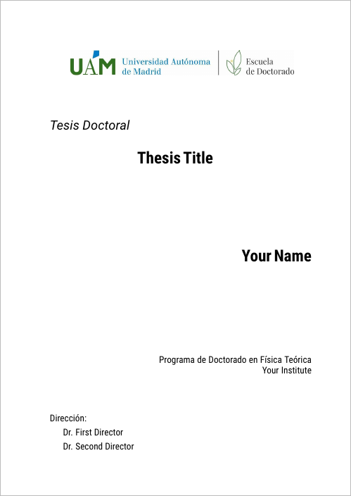

# PhD Physics Thesis - LaTeX Template

A structured LaTeX template for writing a PhD thesis in physics.

```bash
make          # full build → thesis.pdf
make quick    # fast draft (image placeholders)
```

## Showcase

Pages of the PDF that this repository compiles to, with its placeholder content.

<table>
  <tr>
    <td width="33%"></td>
    <td width="33%"></td>
    <td width="33%"></td>
  </tr>
  <tr>
    <td><b>Title page</b> — <code>minimal</code> style: left-aligned on the text block, one accent rule, degree details at the foot; filled in from the metadata macros. The official UAM cover and a plain centred page are alternatives (<a href="#titlepagestyle--stylized-title-pages"><code>\titlepagestyle</code></a>).</td>
    <td><b>Contents</b> — unnumbered Motivation, Conclusiones and Summary listed alongside the numbered chapters; coloured links throughout.</td>
    <td><b>Chapter opening</b> — optional epigraph, chapter mini table of contents and an opening summary that points to every section (<code>\chaptertitleblock</code>; quotes switch off with <code>\showquotesfalse</code>).</td>
  </tr>
  <tr>
    <td></td>
    <td></td>
    <td></td>
  </tr>
  <tr>
    <td><b>Body</b> — Times-style text and maths (newtx), one-and-a-half spacing, running heads, acronyms expanded on first use, TikZ / tikz-feynman diagrams.</td>
    <td><b>Bibliography</b> — journal-style references (biblatex-phys) linked to the DOI, with arXiv numbers, collaboration names and the pages that cite each entry.</td>
    <td><b>Appendices</b> — lettered sections of one chapter, with booktabs tables sized by <code>\fitwidth</code>.</td>
  </tr>
</table>

## Structure

```text
cathersis/
├── thesis.tex                    # Main file: preamble, metadata, document order
├── references.bib                # Bibliography (biblatex + biber, biblatex-phys style)
├── Makefile                      # Build automation (all builds run in .build/)
├── .latexmkrc                    # latexmk configuration (IDE builds)
├── .vscode/                      # VS Code tasks and LaTeX Workshop / LTeX settings
├── STYLEGUIDE.md                 # Writing and formatting conventions
├── chapters/
│   ├── titlepage.tex             # Title page dispatcher (\titlepagestyle)
│   ├── titlepages/               # Title page styles: minimal.tex, default.tex, uam.tex
│   ├── acknowledgements.tex      # Acknowledgements + statement of personal contribution
│   ├── abstract.tex              # Resumen (Spanish) + Abstract
│   ├── 0_chapter/                # Unnumbered Motivation
│   ├── N_chapter/                # One directory per chapter (1–4)
│   │   ├── N_chapter.tex         # Chapter root (subfile, compiles standalone)
│   │   └── N_k_section.tex       # One file per section
│   ├── 5_chapter/                # Conclusiones (Spanish) + Summary
│   └── appendix/                 # Appendices: appendix.tex root, x_appendix.tex + x_y_subsection.tex
├── template/                     # Blank chapter (copy to start a new chapter)
├── references/
│   ├── acronyms/main.tex         # Acronym definitions (glossaries)
│   ├── glossary/main.tex         # Glossary entries
│   ├── metrics/main.tex          # \fom... figure-of-merit macros and \fitwidth
│   ├── style/main.tex            # Colours, chapter title block, review markers, name macros
│   └── quotes/quotes.tex         # Chapter epigraphs
├── results/macros.tex            # Generated \res... result macros (written by analysis scripts)
├── tables/                       # Tabulars, \input with \fitwidth
├── diagrams/                     # Standalone TikZ diagrams
├── equations/                    # Standalone equation fragments
├── figures/                      # Image files (figures/titlepage/ for logos)
└── scripts/                      # check_overfull.py, find_unused_assets.py
```

## Features

- **Numbered chapter directories** — each chapter lives in `chapters/N_chapter/`, compiled independently via the `subfiles` package.
- **Bibliography with biblatex-phys** (biber backend): HEP-journal reference format, journal reference linked to the DOI, arXiv numbers, collaboration names, back-references to the citing pages, duplicate URLs dropped automatically.
- **Stylized title pages** — plain or custom (e.g. the official UAM Escuela de Doctorado cover), selected with one macro.
- **Bilingual front and back matter** — Resumen/Abstract and Conclusiones/Summary, with Spanish hyphenation and unit names (`\spanishsetup`).
- **Chapter openings** — `\chaptertitleblock` prints an optional epigraph, the chapter minitoc and an opening summary.
- **Figures of merit and generated results** — numbers that recur are macros (`\fom...` by hand, `\res...` generated by the analysis), so a change propagates everywhere.
- **Table width control** — `\fitwidth{...}` scales tables wider than the text and widens tables above two thirds of the text width to the full width.
- **Review markers** — `\chk{...}` and the `chkblock` environment print text in red until it is confirmed.
- **Figure attribution** — `\figfrom{key}` and `\adaptedfrom{key}` at the end of captions of external figures.
- **Appendices as lettered sections** of one unnumbered chapter, with per-section float, equation and header numbering.
- **Per-chapter mini tables of contents** via `minitoc`.
- **Glossary and acronyms** managed with the `glossaries` package; defined in `references/acronyms/` and `references/glossary/`.
- **Custom macros and units** in `references/metrics/main.tex`; custom colors and commands in `references/style/main.tex`.
- **Smart cross-references** with `cleveref`; colored hyperlinks via `hyperref`.
- **Unit typesetting** with `siunitx`.
- **TikZ diagrams** in a dedicated `diagrams/` directory.
- **Theorem environments** (theorem, lemma, proposition, corollary, definition, example).
- **Two-sided book layout** with mirrored headers (`scrlayer-scrpage`).
- **Isolated build directory** — all auxiliary files go to `.build/`, keeping the project root clean.
- **`\REVIEWBUILD` toggle** — sets graphics to draft mode for faster iteration.
- **Page-count tracking** (`\pcstart` / `\pcend`) — annotates the PDF with target and actual page spans per section.

## Build System

### Makefile targets

| Command | Description |
| --- | --- |
| `make` | Full build: pdflatex → biber → pdflatex × 2 |
| `make quick` | Single pdflatex pass in review mode (draft graphics) |
| `make chapter CH=<n>` | Build chapter *n* only, review mode |
| `make chapter-full CH=<n>` | Build chapter *n* with bibliography passes |
| `make abstract` | Resumen + Abstract as `thesis_abstract.pdf` |
| `make summary` | Conclusiones + Summary as `thesis_summary.pdf` (`SUMMARY_CH=5` by default) |
| `make clean` | Remove the `.build/` directory |
| `make cleanall` | Remove `.build/` and the output PDF |
| `make view` | Open the PDF with the system viewer |
| `make help` | List all available targets |

### latexmk

A `.latexmkrc` is included for IDE integrations that prefer `latexmk`. It points the output directory to `.build/` and runs biber automatically.

### VS Code tasks (optional)

`.vscode/tasks.json` wraps the make targets above, so editor builds and terminal builds are identical:

| Task | Shortcut / how to run |
| --- | --- |
| Build Thesis (full) | Default build — Ctrl+Shift+B |
| Build Thesis (quick) | Run Task → Build Thesis (quick) |
| Build Chapter | Run Task → Build Chapter, enter chapter number |
| Build Chapter (full) | Run Task → Build Chapter (full), enter chapter number |
| Build Abstract and Summary | Run Task → Build Abstract and Summary |
| Clean | Run Task → Clean |

## Prerequisites

A full LaTeX distribution with `biber` is required (the UAM title page also needs the `roboto` fonts and `tikz-feynman` is used for diagrams):

- **Linux**: `sudo apt-get install texlive-full`
- **macOS**: `brew install --cask mactex`
- **Windows**: Install MiKTeX or TeX Live

## Customization

### Personal information

Edit the metadata macros in the `thesis.tex` preamble (`\thesistitle`, `\thesissubtitle`, `\thesisauthor`, `\thesisprogramme`, `\thesisinstitution`, `\thesisdirectors`, …); every title page style reads them.

### Adding chapters

1. Copy `template/` to `chapters/N_chapter/` and rename every file, replacing `N` with the chapter number.
2. Add the chapter quote and attribution to `references/quotes/quotes.tex` (printed only when `\showquotestrue`, see [Build toggles](#build-toggles)).
3. Add `\subfile{chapters/N_chapter/N_chapter.tex}` in `thesis.tex`.
4. If the Conclusiones/Summary chapter moves, update `SUMMARY_CH` in the `Makefile`.

### Bibliography

Add entries to `references.bib` with titles in sentence case, INSPIRE journal abbreviations, the DOI and arXiv number when they exist, and a `collaboration` field for collaboration papers (see the comments at the top of the file). Cite with `\cite{key}`.

### Glossary and acronyms

Define terms in `references/glossary/main.tex` and acronyms in `references/acronyms/main.tex` using the `glossaries` package macros. The glossary is generated with `\printnoidxglossaries`.

### Style

- **Colors**: defined in `references/style/main.tex` — edit or extend them there.
- **Page margins**: adjust the `geometry` settings in `thesis.tex`.
- **Line spacing**: change `\onehalfspacing` to `\singlespacing` or `\doublespacing`.
- **Font**: swap the `newtxtext`/`newtxmath` lines for another font package.
- **Section depth**: `\setcounter{secnumdepth}` controls numbering depth; `\setcounter{tocdepth}` controls TOC depth.

## Build toggles

### `\REVIEWBUILD` — fast draft mode

Passes `draft` to `graphicx`, replacing all images with bounding-box placeholders. Activated automatically by `make quick`, `make chapter`, and the quick/chapter VS Code tasks. To enable manually:

```bash
pdflatex '\def\REVIEWBUILD{1}\input{thesis.tex}'
```

### `\titlepagestyle` — stylized title pages

Selects which cover is typeset from `chapters/titlepages/<style>.tex`. Set it in the `thesis.tex` preamble, next to the metadata macros (`\thesistitle`, `\thesisauthor`, `\thesisprogramme`, `\thesisdirectors`, …) that every style reads:

```latex
\newcommand{\titlepagestyle}{minimal}   % or: default, uam
```

| Style     | Description |
|-----------|-------------|
| `minimal` | Left-aligned title in the body fonts under a short accent rule; author below; programme, university, institution, directors and month/year set small at the foot (current setting). |
| `default` | Plain centred title page. |
| `uam`     | Official Universidad Autónoma de Madrid (Escuela de Doctorado) cover: Roboto Condensed, UAM logo from `figures/titlepage/`. |

To add a style, create `chapters/titlepages/<name>.tex` containing a `titlepage` environment. An unknown style falls back to `default` with a warning. The `uam` style draws the cover as a TikZ overlay at fixed fractions of the page, independent of the text margins.

<table>
  <tr>
    <td width="33%"></td>
    <td width="33%"></td>
    <td width="33%"></td>
  </tr>
  <tr>
    <td align="center"><code>minimal</code></td>
    <td align="center"><code>default</code></td>
    <td align="center"><code>uam</code></td>
  </tr>
</table>

### `\ifshowquotes` — chapter epigraphs

Each chapter opens with `\chaptertitleblock{quote}{attribution}{summary}` (defined in `references/style/main.tex`). The quote and attribution are the `\QuoteChN` and `\AttribChN` macros of `references/quotes/quotes.tex`. Whether they are printed is set by one switch in `references/style/main.tex`, right above `\chaptertitleblock`:

```latex
\newif\ifshowquotes
\showquotestrue   % quotes printed (current setting)
```

- **Deactivate:** change `\showquotestrue` to `\showquotesfalse` and rebuild. The summary and minitoc are typeset as before; only the quote block is dropped.
- **Activate:** set it back to `\showquotestrue`. Every chapter prints its quote above the minitoc.

The switch acts on all chapters at once. The quote texts and the `\QuoteChN`/`\AttribChN` arguments in the chapter files stay in place, so nothing else has to change. A chapter with an empty first argument never prints a quote. Toggling the quotes changes the length of the chapter openings, so check the page ends (`\ifpagecount`) after switching.

### `\ifpagecount` — page-count tracking

Annotates every section with its target and actual page span in the PDF margin. Useful for tracking writing progress against page budgets.

**Enable:** uncomment `\pagecounttrue` near the top of the `\ifpagecount` block in `thesis.tex`.

**Usage** — bracket any heading with a matching pair:

```latex
\chapter{Introduction}
\pcstart{ch1}{10}        % sets start label; shows "target: 10 pp"
...content...
\pcend{ch1}              % shows "actual: X pp / target: 10 pp"
```

The first argument is a unique identifier (no spaces); the second is the desired page count. When disabled, both commands produce no output.

> Two compile passes are required — labels are written on the first pass and read on the second.

## Version control

Commit only the files needed to compile the full thesis (`make`): sources, and the figures and tables that the compiled chapters actually include. `scripts/find_unused_assets.py` lists figures, tables and diagrams that no compiled file reaches (`--rm` removes them), and `scripts/check_overfull.py thesis.pdf` lists pages whose content sticks out of the text block.

## Tips

1. Compile frequently to catch errors early.
2. Use `make quick` or the quick VS Code task for day-to-day writing; `make` for a clean final build.
3. Label all chapters, sections, equations, figures, and tables for cross-referencing with `\cref`.
4. Keep TikZ diagrams in `diagrams/` and include them with `\input`, so they can be maintained independently.
5. Use `\subfile` in chapter files for nested sub-chapter files to allow standalone compilation at any level.
